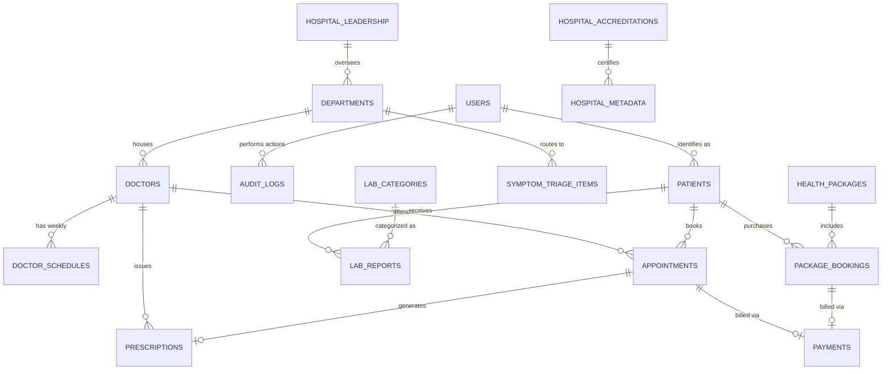

# 🗄️ Gaikwad Critical Care Hospital - Database Design & Schema Specifications

Yeh document **Gaikwad Critical Care Hospital** ke relational database architecture, Entity-Relationship (ER) design, PostgreSQL DDL schemas, indexing strategies, healthcare compliance aur **Phase-by-Phase Database Migration Plan** ka complete blueprint hai.

---

## 1. Database Strategy & Architecture

Gaikwad Critical Care Hospital ek 450-bed tertiary critical care facility hai jisme 60 ICU beds, 24×7 Level-1 Emergency & Trauma Bay, aur NABL-accredited diagnostic labs shamil hain. Healthcare data highly sensitive, relational aur mission-critical hota hai. Iske liye hybrid storage strategy use ki gayi hai:

```
┌────────────────────────────────────────────────────────────────────────────────────────┐
│                                 DATA ARCHITECTURE STRATEGY                             │
├──────────────────────┬────────────────────────┬────────────────────────────────────────┤
│ Database Layer       │ Technology             │ Purpose                                │
├──────────────────────┼────────────────────────┼────────────────────────────────────────┤
│ Primary Relational   │ PostgreSQL 16+         │ ACID Transactions, Foreign Keys,       │
│                      │                        │ JSONB clinical data, Range & Row Locks │
├──────────────────────┼────────────────────────┼────────────────────────────────────────┤
│ High-Speed In-Memory │ Redis 7+               │ Real-time Slot Locks (Mutex Redlock),  │
│                      │                        │ OTP sessions, Triage & Doctor Cache    │
├──────────────────────┼────────────────────────┼────────────────────────────────────────┤
│ Document & File Vault│ AWS S3 / Cloudflare R2 │ Encrypted Lab Reports, PDFs,           │
│                      │                        │ Prescriptions, Doctor Photos           │
└──────────────────────┴────────────────────────┴────────────────────────────────────────┘
```

### Kyon PostgreSQL 16+?

1. **Zero Double-Booking Guarantee:** Strict ACID compliance aur `SELECT ... FOR UPDATE` row locks se do patients ko ek hi doctor slot allot hone se rokta hai.
2. **JSONB Clinical Data Support:** Flexible medical investigations, checkup test parameters, aur patient guide points ko structured tarike se queryable JSONB me store karta hai.
3. **Healthcare Compliance Ready:** Sensitive health data (DISHA / HIPAA principles) ke liye Row-Level Security (RLS) aur append-only immutable audit logs provide karta hai.

---

## 2. Entity-Relationship (ER) Diagram



---

## 3. Phase-by-Phase Database Migration Plan

Database ko hum business phases ke sath progressively expand karenge:

| Phase             | Focus Area                                    | Tables Implemented                                                                                                                              |
| :---------------- | :-------------------------------------------- | :---------------------------------------------------------------------------------------------------------------------------------------------- |
| **Phase 1** | **Core Public, Triage & Booking (MVP)** | `users`, `departments`, `doctors`, `doctor_schedules`, `appointments`, `emergency_leads`, `symptom_triage_items`                  |
| **Phase 2** | **Diagnostics, UHID Vault & Payments**  | `patients` (UHID), `lab_categories`, `lab_reports`, `health_packages`, `package_bookings`, `payments`                               |
| **Phase 3** | **Guides, Telehealth & Insurance**      | `patient_guides`, `prescriptions`, `telehealth_sessions`, `tpa_insurance_queries`, `hospital_leadership`, `hospital_accreditations` |
| **Phase 4** | **Enterprise, Audit & Scale**           | `audit_logs`, `hospital_branches`, `system_settings`, DB Partitioning & Index Tuning                                                      |

---

## 4. Complete Schema & Table Definitions (PostgreSQL DDL)

### 4.1 Phase 1 Tables: Authentication, Doctors, Appointments & Triage

#### 1. `roles` & `users` Table

Hospital staff aur patients ka base authentication record.

```sql
-- Role ENUM
CREATE TYPE user_role AS ENUM (
    'SUPER_ADMIN', 
    'HOSPITAL_STAFF', 
    'DOCTOR', 
    'INTENSIVIST', 
    'LAB_TECHNICIAN', 
    'PATIENT'
);

CREATE TABLE users (
    id UUID PRIMARY KEY DEFAULT gen_random_uuid(),
    phone_number VARCHAR(15) UNIQUE NOT NULL,
    email VARCHAR(255) UNIQUE,
    password_hash VARCHAR(255), -- Patients ke liye NULL ho sakta hai (OTP based)
    role user_role DEFAULT 'PATIENT',
    full_name VARCHAR(150) NOT NULL,
    preferred_language VARCHAR(5) DEFAULT 'en', -- 'en' ya 'hi'
    is_active BOOLEAN DEFAULT TRUE,
    created_at TIMESTAMP WITH TIME ZONE DEFAULT CURRENT_TIMESTAMP,
    updated_at TIMESTAMP WITH TIME ZONE DEFAULT CURRENT_TIMESTAMP
);

CREATE INDEX idx_users_phone ON users(phone_number);
CREATE INDEX idx_users_role ON users(role);
```

#### 2. `departments` Table

Centres of Excellence & Clinical Specialities (Cardiology, Orthopaedics, Neurosciences, etc.).

```sql
CREATE TABLE departments (
    id VARCHAR(50) PRIMARY KEY,                 -- e.g. 'dept-cardio', 'dept-ortho'
    name VARCHAR(120) UNIQUE NOT NULL,          -- e.g. 'Cardiology & Cardiac Surgery'
    slug VARCHAR(100) UNIQUE NOT NULL,          -- e.g. 'cardiology'
    icon_name VARCHAR(50),                      -- Lucide icon identifier
    image_url VARCHAR(500) NOT NULL,            -- Verified high-res photo
    short_desc TEXT NOT NULL,
    full_desc TEXT NOT NULL,
    head_doctor_name VARCHAR(150) NOT NULL,
    key_services TEXT[] NOT NULL,               -- e.g. ARRAY['Angioplasty', 'CABG']
    common_symptoms TEXT[] NOT NULL,
    is_active BOOLEAN DEFAULT TRUE,
    display_order INT DEFAULT 0,
    created_at TIMESTAMP WITH TIME ZONE DEFAULT CURRENT_TIMESTAMP
);

CREATE INDEX idx_departments_slug ON departments(slug);
```

#### 3. `doctors` Table

Specialist doctors ka professional portfolio, qualifications aur OPD charges.

```sql
CREATE TABLE doctors (
    id VARCHAR(50) PRIMARY KEY,                 -- e.g. 'doc-1', 'doc-2'
    user_id UUID UNIQUE REFERENCES users(id) ON DELETE CASCADE,
    department_id VARCHAR(50) NOT NULL REFERENCES departments(id) ON DELETE RESTRICT,
    name VARCHAR(150) NOT NULL,
    registration_number VARCHAR(50) UNIQUE NOT NULL, -- Medical Council Reg No.
    designation VARCHAR(150) NOT NULL,              -- e.g. "Senior Consultant - Interventional Cardiology"
    qualifications VARCHAR(255) NOT NULL,           -- e.g. "MBBS, MD, DM (Cardiology)"
    experience_years INT NOT NULL DEFAULT 5,
    opd_fee DECIMAL(10, 2) NOT NULL DEFAULT 600.00,
    video_consult_fee DECIMAL(10, 2) DEFAULT 800.00,
    room_number VARCHAR(80) NOT NULL,               -- e.g. "Room 104, OPD Block (Ground Floor)"
    bio TEXT,
    photo_url VARCHAR(500) NOT NULL,
    languages_spoken VARCHAR(100)[] DEFAULT ARRAY['English', 'Hindi'],
    is_available_for_teleconsult BOOLEAN DEFAULT TRUE,
    is_active BOOLEAN DEFAULT TRUE,
    created_at TIMESTAMP WITH TIME ZONE DEFAULT CURRENT_TIMESTAMP
);

CREATE INDEX idx_doctors_dept ON doctors(department_id);
```

#### 4. `doctor_schedules` Table

Doctor ka weekly OPD routine.

```sql
CREATE TYPE day_of_week AS ENUM (
    'MONDAY', 'TUESDAY', 'WEDNESDAY', 'THURSDAY', 'FRIDAY', 'SATURDAY', 'SUNDAY'
);

CREATE TABLE doctor_schedules (
    id UUID PRIMARY KEY DEFAULT gen_random_uuid(),
    doctor_id VARCHAR(50) NOT NULL REFERENCES doctors(id) ON DELETE CASCADE,
    day_name day_of_week NOT NULL,
    start_time TIME NOT NULL,        -- e.g. 09:00:00
    end_time TIME NOT NULL,          -- e.g. 13:00:00
    slot_duration_minutes INT DEFAULT 15,
    max_patients_per_slot INT DEFAULT 1,
    is_active BOOLEAN DEFAULT TRUE,
    UNIQUE (doctor_id, day_name, start_time)
);

CREATE INDEX idx_schedules_doctor ON doctor_schedules(doctor_id);
```

#### 5. `appointments` Table

Patients ke OPD aur Online appointments ka core engine.

```sql
CREATE TYPE appointment_status AS ENUM (
    'PENDING', 'CONFIRMED', 'CANCELLED', 'COMPLETED', 'NO_SHOW'
);
CREATE TYPE appointment_type AS ENUM (
    'IN_CLINIC', 'VIDEO_CONSULT'
);

CREATE TABLE appointments (
    id UUID PRIMARY KEY DEFAULT gen_random_uuid(),
    appointment_number VARCHAR(30) UNIQUE NOT NULL, -- e.g. "GCH-APT-20261015-0014"
    doctor_id VARCHAR(50) NOT NULL REFERENCES doctors(id),
    user_id UUID REFERENCES users(id),
  
    patient_name VARCHAR(150) NOT NULL,
    patient_phone VARCHAR(15) NOT NULL,
    patient_age INT NOT NULL,
    patient_gender VARCHAR(10) NOT NULL,
    symptoms_brief TEXT,
  
    appointment_date DATE NOT NULL,
    slot_start_time TIME NOT NULL,
    slot_end_time TIME NOT NULL,
  
    appointment_type appointment_type DEFAULT 'IN_CLINIC',
    status appointment_status DEFAULT 'CONFIRMED',
    token_number INT NOT NULL,                      -- Queue token on OPD counter
  
    payment_status VARCHAR(20) DEFAULT 'PENDING',  -- 'PAID', 'PENDING', 'AT_HOSPITAL'
    cancellation_reason TEXT,
    created_at TIMESTAMP WITH TIME ZONE DEFAULT CURRENT_TIMESTAMP,
    updated_at TIMESTAMP WITH TIME ZONE DEFAULT CURRENT_TIMESTAMP,
  
    -- Concurrency Race Condition Prevention:
    UNIQUE (doctor_id, appointment_date, slot_start_time)
);

CREATE INDEX idx_appointments_doc_date ON appointments(doctor_id, appointment_date);
CREATE INDEX idx_appointments_phone ON appointments(patient_phone);
CREATE INDEX idx_appointments_status ON appointments(status);
```

#### 6. `symptom_triage_items` Table

Clinical Triage routing engine ("What are you feeling?").

```sql
CREATE TYPE urgency_level AS ENUM ('CRITICAL', 'HIGH', 'MODERATE');

CREATE TABLE symptom_triage_items (
    id VARCHAR(50) PRIMARY KEY,                 -- e.g. 'sym-1', 'sym-2'
    symptom VARCHAR(150) NOT NULL,              -- e.g. "Severe chest pressure or sudden pain"
    team VARCHAR(150) NOT NULL,                 -- e.g. "Emergency & Cardiac Science Team"
    department_id VARCHAR(50) NOT NULL REFERENCES departments(id),
    urgency urgency_level DEFAULT 'CRITICAL',
    is_active BOOLEAN DEFAULT TRUE,
    display_order INT DEFAULT 0,
    created_at TIMESTAMP WITH TIME ZONE DEFAULT CURRENT_TIMESTAMP
);

CREATE INDEX idx_triage_dept ON symptom_triage_items(department_id);
```

#### 7. `emergency_leads` Table

24×7 Ambulance & Emergency Mobile ICU request tracking.

```sql
CREATE TABLE emergency_leads (
    id UUID PRIMARY KEY DEFAULT gen_random_uuid(),
    caller_name VARCHAR(150),
    caller_phone VARCHAR(15) NOT NULL,
    emergency_type VARCHAR(100) DEFAULT 'CARDIAC_EMERGENCY', -- 'CARDIAC', 'POLYTRAUMA', 'STROKE', 'AMBULANCE'
    location_address TEXT,
    latitude DECIMAL(10, 8),
    longitude DECIMAL(11, 8),
    status VARCHAR(20) DEFAULT 'NEW',                       -- 'NEW', 'DISPATCHED', 'RESOLVED'
    assigned_staff_id UUID REFERENCES users(id),
    notes TEXT,
    created_at TIMESTAMP WITH TIME ZONE DEFAULT CURRENT_TIMESTAMP
);

CREATE INDEX idx_emergency_status ON emergency_leads(status);
```

---

### 4.2 Phase 2 Tables: Diagnostics, UHID Vault & Multi-Purpose Payments

#### 8. `patients` Table (UHID Central Directory)

Hospital master health identity record.

```sql
CREATE TABLE patients (
    id UUID PRIMARY KEY DEFAULT gen_random_uuid(),
    uhid VARCHAR(30) UNIQUE NOT NULL, -- e.g. "GCH-2026-9081"
    user_id UUID UNIQUE REFERENCES users(id) ON DELETE SET NULL,
    full_name VARCHAR(150) NOT NULL,
    phone_number VARCHAR(15) NOT NULL,
    date_of_birth DATE,
    gender VARCHAR(10),
    blood_group VARCHAR(5),           -- 'O+', 'A+', 'B+', etc.
    address TEXT,
    emergency_contact_name VARCHAR(150),
    emergency_contact_phone VARCHAR(15),
    created_at TIMESTAMP WITH TIME ZONE DEFAULT CURRENT_TIMESTAMP
);

CREATE INDEX idx_patients_uhid ON patients(uhid);
CREATE INDEX idx_patients_phone ON patients(phone_number);
```

#### 9. `lab_categories` & `lab_reports` Table

Lab tests ke encrypted digital records with secure S3 storage keys.

```sql
CREATE TABLE lab_categories (
    id UUID PRIMARY KEY DEFAULT gen_random_uuid(),
    name VARCHAR(100) NOT NULL,       -- e.g. 'Pathology', 'Radiology (3T MRI / 128-Slice CT)'
    slug VARCHAR(100) UNIQUE NOT NULL
);

CREATE TABLE lab_reports (
    id UUID PRIMARY KEY DEFAULT gen_random_uuid(),
    report_number VARCHAR(30) UNIQUE NOT NULL, -- e.g. "GCH-RPT-2026-8812"
    patient_id UUID NOT NULL REFERENCES patients(id) ON DELETE CASCADE,
    category_id UUID NOT NULL REFERENCES lab_categories(id),
    test_name VARCHAR(200) NOT NULL,          -- e.g. "Complete Blood Count (CBC)", "Coronary Angio Scan"
  
    file_storage_key VARCHAR(500) NOT NULL,   -- S3 Private bucket object key
    file_mime_type VARCHAR(50) DEFAULT 'application/pdf',
    file_size_bytes BIGINT,
  
    uploaded_by UUID REFERENCES users(id),    -- Lab technician ID
    is_verified BOOLEAN DEFAULT TRUE,
    test_date DATE NOT NULL,
    created_at TIMESTAMP WITH TIME ZONE DEFAULT CURRENT_TIMESTAMP
);

CREATE INDEX idx_lab_reports_patient ON lab_reports(patient_id);
CREATE INDEX idx_lab_reports_number ON lab_reports(report_number);
```

#### 10. `health_packages` & `package_bookings` Table

Preventive health checkups packages and purchases.

```sql
CREATE TABLE health_packages (
    id VARCHAR(50) PRIMARY KEY,               -- e.g. 'pkg-1', 'pkg-2'
    title VARCHAR(150) NOT NULL,              -- e.g. "Comprehensive Full Body Checkup"
    slug VARCHAR(150) UNIQUE NOT NULL,
    tagline VARCHAR(255),
    price DECIMAL(10, 2) NOT NULL,
    discounted_price DECIMAL(10, 2),
    fasting_required BOOLEAN DEFAULT TRUE,
    total_tests INT NOT NULL DEFAULT 40,
    included_tests JSONB NOT NULL,           -- Array of strings e.g. ["Lipid Profile", "HbA1c"]
    instructions TEXT,
    is_active BOOLEAN DEFAULT TRUE,
    created_at TIMESTAMP WITH TIME ZONE DEFAULT CURRENT_TIMESTAMP
);

CREATE TABLE package_bookings (
    id UUID PRIMARY KEY DEFAULT gen_random_uuid(),
    booking_number VARCHAR(30) UNIQUE NOT NULL,
    package_id VARCHAR(50) NOT NULL REFERENCES health_packages(id),
    user_id UUID REFERENCES users(id),
    patient_name VARCHAR(150) NOT NULL,
    patient_phone VARCHAR(15) NOT NULL,
    preferred_date DATE NOT NULL,
    status VARCHAR(20) DEFAULT 'BOOKED',     -- 'BOOKED', 'SAMPLE_COLLECTED', 'COMPLETED'
    created_at TIMESTAMP WITH TIME ZONE DEFAULT CURRENT_TIMESTAMP
);
```

#### 11. `payments` Table (Multi-Purpose Hospital Billing)

Razorpay transactions for OPD, IPD deposit, diagnostics and packages.

```sql
CREATE TYPE payment_gateway AS ENUM (
    'RAZORPAY', 'STRIPE', 'OFFLINE_CASH', 'POS_CARD'
);
CREATE TYPE payment_purpose AS ENUM (
    'OPD_CONSULTATION', 
    'IPD_ADVANCE_DEPOSIT', 
    'DIAGNOSTICS_BILLING', 
    'HEALTH_PACKAGE'
);

CREATE TABLE payments (
    id UUID PRIMARY KEY DEFAULT gen_random_uuid(),
    invoice_number VARCHAR(50) UNIQUE NOT NULL, -- e.g. "GCH-INV-2026-9021"
    user_id UUID REFERENCES users(id),
    uhid VARCHAR(30),
    appointment_id UUID REFERENCES appointments(id),
    package_booking_id UUID REFERENCES package_bookings(id),
  
    purpose payment_purpose NOT NULL DEFAULT 'OPD_CONSULTATION',
    amount DECIMAL(10, 2) NOT NULL,
    currency VARCHAR(5) DEFAULT 'INR',
    gateway payment_gateway DEFAULT 'RAZORPAY',
    gateway_order_id VARCHAR(100),
    gateway_payment_id VARCHAR(100),
    gateway_signature VARCHAR(255),
  
    status VARCHAR(20) DEFAULT 'SUCCESS', -- 'SUCCESS', 'FAILED', 'REFUNDED'
    receipt_pdf_url VARCHAR(500),
    created_at TIMESTAMP WITH TIME ZONE DEFAULT CURRENT_TIMESTAMP
);

CREATE INDEX idx_payments_order_id ON payments(gateway_order_id);
CREATE INDEX idx_payments_purpose ON payments(purpose);
```

---

### 4.3 Phase 3 Tables: Guides, Leadership, Accreditations & Insurance

#### 12. `patient_guides` Table

Visitor & In-Patient Guide Knowledge Base.

```sql
CREATE TABLE patient_guides (
    id VARCHAR(50) PRIMARY KEY,                 -- e.g. 'guide-1', 'guide-2'
    title VARCHAR(150) NOT NULL,              -- e.g. "What to Bring for Admission"
    summary TEXT NOT NULL,
    points JSONB NOT NULL,                    -- Array of checklist strings
    link_text VARCHAR(100) DEFAULT 'Read Guide',
    downloadable_pdf_url VARCHAR(500),
    is_active BOOLEAN DEFAULT TRUE,
    display_order INT DEFAULT 0,
    created_at TIMESTAMP WITH TIME ZONE DEFAULT CURRENT_TIMESTAMP
);
```

#### 13. `hospital_leadership` Table

Director Message & Senior Clinical Governance profile.

```sql
CREATE TABLE hospital_leadership (
    id VARCHAR(50) PRIMARY KEY,                 -- e.g. 'dir-1'
    name VARCHAR(150) NOT NULL,               -- e.g. "Dr. Rajesh Gaikwad"
    role VARCHAR(150) NOT NULL,               -- e.g. "Founder & Medical Director"
    qualifications VARCHAR(255) NOT NULL,     -- e.g. "MBBS, MS (General Surgery), MCh (Trauma & Critical Care)"
    experience_years INT NOT NULL DEFAULT 28,
    message_quote TEXT NOT NULL,
    photo_url VARCHAR(500) NOT NULL,
    signature_url VARCHAR(500),
    created_at TIMESTAMP WITH TIME ZONE DEFAULT CURRENT_TIMESTAMP
);
```

#### 14. `hospital_accreditations` Table

Recognitions & Accreditations (NABH, NABL, ISO, AERB, JCI).

```sql
CREATE TABLE hospital_accreditations (
    id VARCHAR(50) PRIMARY KEY,                 -- e.g. 'acc-nabh', 'acc-nabl'
    label VARCHAR(150) NOT NULL,              -- e.g. "NABH Accredited Hospital"
    issuing_body VARCHAR(150) NOT NULL,
    badge_icon_url VARCHAR(500),
    certificate_number VARCHAR(100),
    valid_until DATE,
    is_active BOOLEAN DEFAULT TRUE
);
```

#### 15. `prescriptions` Table

Doctor dwara consultation ke baad generate kiya gaya official digital prescription.

```sql
CREATE TABLE prescriptions (
    id UUID PRIMARY KEY DEFAULT gen_random_uuid(),
    appointment_id UUID UNIQUE REFERENCES appointments(id) ON DELETE CASCADE,
    doctor_id VARCHAR(50) NOT NULL REFERENCES doctors(id),
    patient_id UUID NOT NULL REFERENCES patients(id),
  
    diagnosis TEXT NOT NULL,
    clinical_notes TEXT,
    medicines JSONB NOT NULL, -- [{ name: "Aspirin 75mg", dosage: "0-1-0", duration: "30 days" }]
    recommended_lab_tests VARCHAR(255)[],
    follow_up_date DATE,
    prescription_pdf_key VARCHAR(500),
    created_at TIMESTAMP WITH TIME ZONE DEFAULT CURRENT_TIMESTAMP
);

CREATE INDEX idx_prescriptions_patient ON prescriptions(patient_id);
```

#### 16. `tpa_insurance_queries` Table

Patients dwara insurance cashless claim verification form entries.

```sql
CREATE TABLE tpa_insurance_queries (
    id UUID PRIMARY KEY DEFAULT gen_random_uuid(),
    patient_name VARCHAR(150) NOT NULL,
    phone_number VARCHAR(15) NOT NULL,
    insurance_company_name VARCHAR(150) NOT NULL, -- e.g. "Star Health", "HDFC ERGO", "Niva Bupa"
    policy_number VARCHAR(100) NOT NULL,
    policy_document_s3_key VARCHAR(500),
    planned_treatment VARCHAR(150),
    status VARCHAR(20) DEFAULT 'IN_REVIEW',      -- 'IN_REVIEW', 'ELIGIBLE', 'REJECTED'
    reviewer_notes TEXT,
    reviewed_by UUID REFERENCES users(id),
    created_at TIMESTAMP WITH TIME ZONE DEFAULT CURRENT_TIMESTAMP
);
```

---

### 4.4 Phase 4 Tables: Enterprise Audit Logs & Content Synchronizations

#### 17. `audit_logs` Table (Medical Compliance & Safety)

DISHA aur HIPAA norms ke tahat har sensitive health record ka access permanently log hota hai.

```sql
CREATE TABLE audit_logs (
    id BIGSERIAL PRIMARY KEY,
    user_id UUID REFERENCES users(id) ON DELETE SET NULL,
    user_role user_role,
    action VARCHAR(50) NOT NULL,        -- 'VIEW_LAB_REPORT', 'UPDATE_PRESCRIPTION', 'EXPORT_PATIENTS'
    resource_type VARCHAR(50) NOT NULL, -- 'LAB_REPORT', 'PATIENT_PROFILE'
    resource_id VARCHAR(100) NOT NULL,
    ip_address INET,
    user_agent TEXT,
    timestamp TIMESTAMP WITH TIME ZONE DEFAULT CURRENT_TIMESTAMP
);

CREATE INDEX idx_audit_resource ON audit_logs(resource_type, resource_id);
CREATE INDEX idx_audit_timestamp ON audit_logs(timestamp);
```

#### 18. `faqs`, `blog_posts`, `testimonials` & `hospital_facilities` Tables

```sql
CREATE TABLE faqs (
    id UUID PRIMARY KEY DEFAULT gen_random_uuid(),
    question VARCHAR(255) NOT NULL,
    answer TEXT NOT NULL,
    category VARCHAR(50) DEFAULT 'OPD', -- 'OPD', 'EMERGENCY', 'INSURANCE', 'REPORTS', 'VISITORS'
    is_active BOOLEAN DEFAULT TRUE,
    display_order INT DEFAULT 0,
    created_at TIMESTAMP WITH TIME ZONE DEFAULT CURRENT_TIMESTAMP
);

CREATE TABLE blog_posts (
    id UUID PRIMARY KEY DEFAULT gen_random_uuid(),
    title VARCHAR(255) NOT NULL,
    slug VARCHAR(255) UNIQUE NOT NULL,
    excerpt TEXT,
    content TEXT NOT NULL,
    category VARCHAR(100) NOT NULL,            -- 'Heart Health', 'Critical Care', 'Neuro Surgery'
    cover_image_url VARCHAR(500),
    author_doctor_name VARCHAR(150),
    reading_time VARCHAR(20) DEFAULT '4 min read',
    is_published BOOLEAN DEFAULT TRUE,
    published_at TIMESTAMP WITH TIME ZONE DEFAULT CURRENT_TIMESTAMP,
    created_at TIMESTAMP WITH TIME ZONE DEFAULT CURRENT_TIMESTAMP
);

CREATE TABLE testimonials (
    id UUID PRIMARY KEY DEFAULT gen_random_uuid(),
    patient_name VARCHAR(150) NOT NULL,
    rating INT CHECK (rating >= 1 AND rating <= 5) DEFAULT 5,
    treatment VARCHAR(150) NOT NULL,          -- e.g. "Emergency STEMI Heart Attack Angioplasty"
    quote TEXT NOT NULL,
    doctor_name VARCHAR(150) NOT NULL,
    date VARCHAR(50) NOT NULL,
    avatar_url VARCHAR(500) NOT NULL,
    video_thumbnail VARCHAR(500),
    is_approved BOOLEAN DEFAULT TRUE,
    created_at TIMESTAMP WITH TIME ZONE DEFAULT CURRENT_TIMESTAMP
);

CREATE TABLE hospital_facilities (
    id UUID PRIMARY KEY DEFAULT gen_random_uuid(),
    title VARCHAR(150) NOT NULL,               -- e.g. "Dedicated 60-Bed ICU Suite", "Dual Flat-Panel Cath Lab"
    category VARCHAR(50) NOT NULL,             -- 'ICU', 'OT', 'ROOMS', 'DIAGNOSTICS'
    description TEXT,
    image_url VARCHAR(500) NOT NULL,
    is_featured BOOLEAN DEFAULT TRUE,
    display_order INT DEFAULT 0,
    created_at TIMESTAMP WITH TIME ZONE DEFAULT CURRENT_TIMESTAMP
);
```

---

## 5. Concurrency & Performance Optimizations

### 1. Atomic Slot Double-Booking Prevention Logic

```sql
-- Database Transaction with Row-Level Lock
BEGIN;
SELECT id FROM appointments 
WHERE doctor_id = $1 
  AND appointment_date = $2 
  AND slot_start_time = $3 
FOR UPDATE;

-- Agar slot khali hai, insert karein:
INSERT INTO appointments (
    appointment_number, doctor_id, patient_name, patient_phone, 
    patient_age, patient_gender, appointment_date, slot_start_time, 
    slot_end_time, token_number
) VALUES ($1, $2, $3, $4, $5, $6, $7, $8, $9, $10);
COMMIT;
```

### 2. Fast Doctor Availability Search Query

```sql
SELECT s.start_time, s.end_time 
FROM doctor_schedules s
WHERE s.doctor_id = $1 
  AND s.day_name = $2
  AND s.start_time NOT IN (
      SELECT a.slot_start_time 
      FROM appointments a 
      WHERE a.doctor_id = $1 
        AND a.appointment_date = $3 
        AND a.status IN ('CONFIRMED', 'PENDING')
  );
```

---

## 6. Data Backup & Healthcare Security Guidelines

1. **Daily Automated Snapshots:** AWS RDS PostgreSQL par automated daily backups with 30-day Point-In-Time Recovery (PITR).
2. **PII Masking:** Logs aur analytics queries me phone numbers aur full names ko mask kiya jayega (`+91 98****8108`).
3. **Partitioning Plan (For 1M+ Records):** Appointments aur audit logs tables ko `appointment_date` (Year/Month) par partitioned table me organize kiya jayega taaki query performance kabhi degrade na ho.
