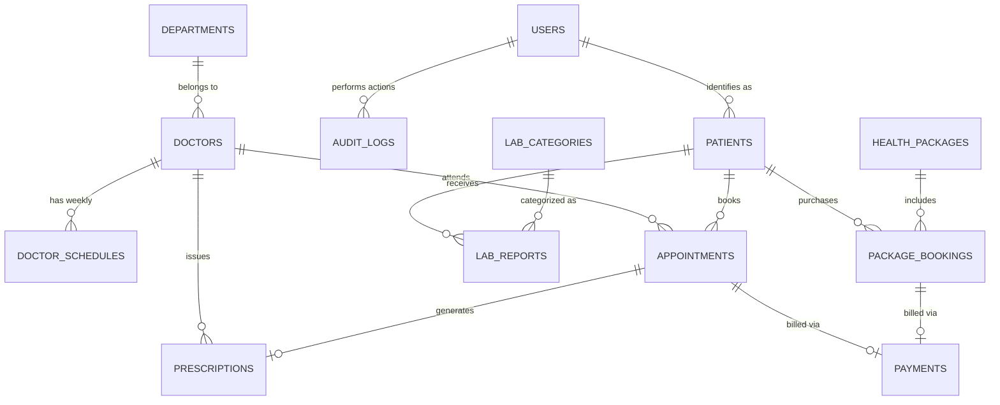

# 🗄️ Hospital Portfolio & Management System - Database Design

Yeh document hospital platform ke database architecture, Entity-Relationship (ER) design, relational table schemas (PostgreSQL), data privacy compliance aur **Phase-by-Phase Database Migration Plan** ka detailed blueprint hai.

---

## 1. Database Selection & Strategy

Hospital data highly sensitive, relational aur mission-critical hota hai. Iske liye hum ek hybrid data strategy use karte hain:

```
┌──────────────────────────────────────────────────────────────────────────────────┐
│                             DATA ARCHITECTURE STRATEGY                           │
├──────────────────────┬────────────────────────┬──────────────────────────────────┤
│ Database Layer       │ Technology             │ Purpose                          │
├──────────────────────┼────────────────────────┼──────────────────────────────────┤
│ Primary Relational   │ PostgreSQL 16+         │ ACID Transactions, Foreign Keys, │
│                      │                        │ JSONB medical data, Range types  │
├──────────────────────┼────────────────────────┼──────────────────────────────────┤
│ High-Speed In-Memory │ Redis 7+               │ Real-time Slot Locks (Mutex),    │
│                      │                        │ OTP sessions, Cache layers       │
├──────────────────────┼────────────────────────┼──────────────────────────────────┤
│ Document & File Vault│ AWS S3 / Cloudflare R2 │ Encrypted Medical Reports, PDFs, │
│                      │                        │ Prescriptions, Doctor Photos     │
└──────────────────────┴────────────────────────┴──────────────────────────────────┘
```

### Kyon PostgreSQL?
1. **Zero Double-Booking Guarantee:** Strong ACID compliance aur `SELECT FOR UPDATE` row locks se do patients ko ek hi slot allot hone se rokta hai.
2. **JSONB Support:** Medical reports aur test parameters (e.g., Hemoglobin count, Blood sugar levels) dynamically change ho sakte hain, jise JSONB me structured store kiya ja sakta hai.
3. **Compliance Ready:** Sensitive healthcare data (DISHA / HIPAA) ke liye row-level security aur append-only audit trails support karta hai.

---

## 2. Entity-Relationship (ER) Diagram



---

## 3. Phase-by-Phase Database Migration Plan

Database ko hum business phases ke sath progressively expand karenge taaki pehle din system over-complicated na bane:

| Phase | Focus Area | Tables Implemented |
| :--- | :--- | :--- |
| **Phase 1** | **Core Public & Booking (MVP)** | `users`, `roles`, `departments`, `doctors`, `doctor_schedules`, `appointments`, `emergency_leads` |
| **Phase 2** | **Diagnostics & Payments** | `patients` (UHID), `lab_categories`, `lab_reports`, `health_packages`, `package_bookings`, `payments` |
| **Phase 3** | **Telehealth & Insurance** | `prescriptions`, `telehealth_sessions`, `tpa_insurance_queries`, `notification_logs` |
| **Phase 4** | **Enterprise, Audit & Scale** | `audit_logs`, `hospital_branches`, `system_settings`, DB Partitioning & Indexes tuning |

---

## 4. Complete Schema & Table Definitions (PostgreSQL DDL)

### 4.1 Phase 1 Tables: Authentication, Doctors & Appointments

#### 1. `roles` & `users` Table
Hospital staff aur patients ka base authentication record.

```sql
-- Role ENUM
CREATE TYPE user_role AS ENUM ('SUPER_ADMIN', 'HOSPITAL_STAFF', 'DOCTOR', 'LAB_TECHNICIAN', 'PATIENT');

CREATE TABLE users (
    id UUID PRIMARY KEY DEFAULT gen_random_uuid(),
    phone_number VARCHAR(15) UNIQUE NOT NULL,
    email VARCHAR(255) UNIQUE,
    password_hash VARCHAR(255), -- Patients ke liye NULL ho sakta hai (OTP based)
    role user_role DEFAULT 'PATIENT',
    full_name VARCHAR(150) NOT NULL,
    is_active BOOLEAN DEFAULT TRUE,
    created_at TIMESTAMP WITH TIME ZONE DEFAULT CURRENT_TIMESTAMP,
    updated_at TIMESTAMP WITH TIME ZONE DEFAULT CURRENT_TIMESTAMP
);

CREATE INDEX idx_users_phone ON users(phone_number);
CREATE INDEX idx_users_role ON users(role);
```

#### 2. `departments` Table
Centres of Excellence & Clinical Specialities (e.g., Cardiology, Neurology).

```sql
CREATE TABLE departments (
    id UUID PRIMARY KEY DEFAULT gen_random_uuid(),
    name VARCHAR(100) UNIQUE NOT NULL,
    slug VARCHAR(100) UNIQUE NOT NULL,
    icon_url VARCHAR(500),
    cover_image_url VARCHAR(500),
    description TEXT,
    is_active BOOLEAN DEFAULT TRUE,
    display_order INT DEFAULT 0,
    created_at TIMESTAMP WITH TIME ZONE DEFAULT CURRENT_TIMESTAMP
);

CREATE INDEX idx_departments_slug ON departments(slug);
```

#### 3. `doctors` Table
Specialist doctors ka professional portfolio, qualification aur OPD charges.

```sql
CREATE TABLE doctors (
    id UUID PRIMARY KEY DEFAULT gen_random_uuid(),
    user_id UUID UNIQUE REFERENCES users(id) ON DELETE CASCADE,
    department_id UUID NOT NULL REFERENCES departments(id) ON DELETE RESTRICT,
    registration_number VARCHAR(50) UNIQUE NOT NULL, -- Medical Council Reg No.
    designation VARCHAR(150) NOT NULL,              -- e.g. "Senior Consultant - Interventional Cardiology"
    qualifications VARCHAR(255) NOT NULL,           -- e.g. "MBBS, MD, DM (Cardiology)"
    experience_years INT NOT NULL DEFAULT 1,
    opd_fee DECIMAL(10, 2) NOT NULL DEFAULT 500.00,
    video_consult_fee DECIMAL(10, 2) DEFAULT 700.00,
    room_number VARCHAR(50),                        -- Hospital room/cabin no.
    bio TEXT,
    profile_photo_url VARCHAR(500),
    languages_spoken VARCHAR(100)[] DEFAULT ARRAY['English', 'Hindi'],
    is_available_for_teleconsult BOOLEAN DEFAULT FALSE,
    is_active BOOLEAN DEFAULT TRUE,
    created_at TIMESTAMP WITH TIME ZONE DEFAULT CURRENT_TIMESTAMP
);

CREATE INDEX idx_doctors_dept ON doctors(department_id);
```

#### 4. `doctor_schedules` Table
Doctor ka weekly OPD routine (Kaun se din, kis time se kis time tak).

```sql
CREATE TYPE day_of_week AS ENUM ('MONDAY', 'TUESDAY', 'WEDNESDAY', 'THURSDAY', 'FRIDAY', 'SATURDAY', 'SUNDAY');

CREATE TABLE doctor_schedules (
    id UUID PRIMARY KEY DEFAULT gen_random_uuid(),
    doctor_id UUID NOT NULL REFERENCES doctors(id) ON DELETE CASCADE,
    day_name day_of_week NOT NULL,
    start_time TIME NOT NULL,        -- e.g. 10:00:00
    end_time TIME NOT NULL,          -- e.g. 14:00:00
    slot_duration_minutes INT DEFAULT 15, -- 15 mins per patient
    max_patients_per_slot INT DEFAULT 1,
    is_active BOOLEAN DEFAULT TRUE,
    UNIQUE (doctor_id, day_name, start_time)
);

CREATE INDEX idx_schedules_doctor ON doctor_schedules(doctor_id);
```

#### 5. `appointments` Table
Patients ke OPD aur Online appointments ka core engine.

```sql
CREATE TYPE appointment_status AS ENUM ('PENDING', 'CONFIRMED', 'CANCELLED', 'COMPLETED', 'NO_SHOW');
CREATE TYPE appointment_type AS ENUM ('IN_CLINIC', 'VIDEO_CONSULT');

CREATE TABLE appointments (
    id UUID PRIMARY KEY DEFAULT gen_random_uuid(),
    appointment_number VARCHAR(20) UNIQUE NOT NULL, -- e.g. "APT-20261011-0023"
    doctor_id UUID NOT NULL REFERENCES doctors(id),
    user_id UUID REFERENCES users(id),              -- NULL if booked by guest before register
    
    -- Patient Details (Emergency/Direct entry ke liye)
    patient_name VARCHAR(150) NOT NULL,
    patient_phone VARCHAR(15) NOT NULL,
    patient_age INT NOT NULL,
    patient_gender VARCHAR(10) NOT NULL,
    symptoms_brief TEXT,
    
    appointment_date DATE NOT NULL,
    slot_start_time TIME NOT NULL,
    slot_end_time TIME NOT NULL,
    
    appointment_type appointment_type DEFAULT 'IN_CLINIC',
    status appointment_status DEFAULT 'CONFIRMED',
    token_number INT NOT NULL,                      -- Queue token on OPD counter
    
    payment_status VARCHAR(20) DEFAULT 'PENDING',  -- 'PAID', 'PENDING', 'AT_HOSPITAL'
    cancellation_reason TEXT,
    created_at TIMESTAMP WITH TIME ZONE DEFAULT CURRENT_TIMESTAMP,
    updated_at TIMESTAMP WITH TIME ZONE DEFAULT CURRENT_TIMESTAMP,
    
    -- Race condition prevention constraint:
    UNIQUE (doctor_id, appointment_date, slot_start_time)
);

CREATE INDEX idx_appointments_doc_date ON appointments(doctor_id, appointment_date);
CREATE INDEX idx_appointments_phone ON appointments(patient_phone);
CREATE INDEX idx_appointments_status ON appointments(status);
```

#### 6. `emergency_leads` Table
24x7 Ambulance & Emergency requests tracking.

```sql
CREATE TABLE emergency_leads (
    id UUID PRIMARY KEY DEFAULT gen_random_uuid(),
    caller_name VARCHAR(150),
    caller_phone VARCHAR(15) NOT NULL,
    emergency_type VARCHAR(100) DEFAULT 'AMBULANCE_REQUEST', -- 'ACCIDENT', 'CARDIAC', 'GENERAL'
    location_address TEXT,
    latitude DECIMAL(10, 8),
    longitude DECIMAL(11, 8),
    status VARCHAR(20) DEFAULT 'NEW',                       -- 'NEW', 'DISPATCHED', 'RESOLVED'
    assigned_staff_id UUID REFERENCES users(id),
    created_at TIMESTAMP WITH TIME ZONE DEFAULT CURRENT_TIMESTAMP
);

CREATE INDEX idx_emergency_status ON emergency_leads(status);
```

---

### 4.2 Phase 2 Tables: Diagnostics, UHID Vault & Payments

#### 7. `patients` Table (UHID Central Directory)
Hospital me patient ka official master health identity record.

```sql
CREATE TABLE patients (
    id UUID PRIMARY KEY DEFAULT gen_random_uuid(),
    uhid VARCHAR(30) UNIQUE NOT NULL, -- Unique Hospital ID: e.g. "HOSP-2026-9081"
    user_id UUID UNIQUE REFERENCES users(id) ON DELETE SET NULL,
    full_name VARCHAR(150) NOT NULL,
    phone_number VARCHAR(15) NOT NULL,
    date_of_birth DATE,
    gender VARCHAR(10),
    blood_group VARCHAR(5),           -- 'O+', 'A+', 'B+', etc.
    address TEXT,
    emergency_contact_name VARCHAR(150),
    emergency_contact_phone VARCHAR(15),
    created_at TIMESTAMP WITH TIME ZONE DEFAULT CURRENT_TIMESTAMP
);

CREATE INDEX idx_patients_uhid ON patients(uhid);
CREATE INDEX idx_patients_phone ON patients(phone_number);
```

#### 8. `lab_categories` & `lab_reports` Table
Lab tests ke digitally uploaded records with secure S3 storage keys.

```sql
CREATE TABLE lab_categories (
    id UUID PRIMARY KEY DEFAULT gen_random_uuid(),
    name VARCHAR(100) NOT NULL,       -- e.g. 'Pathology', 'Radiology (X-Ray/MRI)', 'Biochemistry'
    slug VARCHAR(100) UNIQUE NOT NULL
);

CREATE TABLE lab_reports (
    id UUID PRIMARY KEY DEFAULT gen_random_uuid(),
    report_number VARCHAR(30) UNIQUE NOT NULL, -- e.g. "RPT-2026-8812"
    patient_id UUID NOT NULL REFERENCES patients(id) ON DELETE CASCADE,
    category_id UUID NOT NULL REFERENCES lab_categories(id),
    test_name VARCHAR(200) NOT NULL,          -- e.g. "Complete Blood Count (CBC)", "Lipid Profile"
    
    file_storage_key VARCHAR(500) NOT NULL,   -- S3 Private bucket object key
    file_mime_type VARCHAR(50) DEFAULT 'application/pdf',
    file_size_bytes BIGINT,
    
    uploaded_by UUID REFERENCES users(id),    -- Lab technician ID
    is_verified BOOLEAN DEFAULT TRUE,
    test_date DATE NOT NULL,
    created_at TIMESTAMP WITH TIME ZONE DEFAULT CURRENT_TIMESTAMP
);

CREATE INDEX idx_lab_reports_patient ON lab_reports(patient_id);
CREATE INDEX idx_lab_reports_number ON lab_reports(report_number);
```

#### 9. `health_packages` & `package_bookings` Table
Preventive health checkups packages and purchases.

```sql
CREATE TABLE health_packages (
    id UUID PRIMARY KEY DEFAULT gen_random_uuid(),
    title VARCHAR(150) NOT NULL,              -- e.g. "Comprehensive Executive Health Checkup"
    slug VARCHAR(150) UNIQUE NOT NULL,
    tagline VARCHAR(255),
    price DECIMAL(10, 2) NOT NULL,
    discounted_price DECIMAL(10, 2),
    fasting_required BOOLEAN DEFAULT TRUE,
    included_tests JSONB NOT NULL,           -- Array of string test names
    instructions TEXT,
    is_active BOOLEAN DEFAULT TRUE,
    created_at TIMESTAMP WITH TIME ZONE DEFAULT CURRENT_TIMESTAMP
);

CREATE TABLE package_bookings (
    id UUID PRIMARY KEY DEFAULT gen_random_uuid(),
    booking_number VARCHAR(30) UNIQUE NOT NULL,
    package_id UUID NOT NULL REFERENCES health_packages(id),
    user_id UUID REFERENCES users(id),
    patient_name VARCHAR(150) NOT NULL,
    patient_phone VARCHAR(15) NOT NULL,
    preferred_date DATE NOT NULL,
    status VARCHAR(20) DEFAULT 'BOOKED',     -- 'BOOKED', 'SAMPLE_COLLECTED', 'COMPLETED'
    created_at TIMESTAMP WITH TIME ZONE DEFAULT CURRENT_TIMESTAMP
);
```

#### 10. `payments` Table
Razorpay/Stripe transactions aur billing record.

```sql
CREATE TYPE payment_gateway AS ENUM ('RAZORPAY', 'STRIPE', 'OFFLINE_CASH', 'POS_CARD');

CREATE TABLE payments (
    id UUID PRIMARY KEY DEFAULT gen_random_uuid(),
    invoice_number VARCHAR(50) UNIQUE NOT NULL,
    user_id UUID REFERENCES users(id),
    appointment_id UUID REFERENCES appointments(id),
    package_booking_id UUID REFERENCES package_bookings(id),
    
    amount DECIMAL(10, 2) NOT NULL,
    currency VARCHAR(5) DEFAULT 'INR',
    gateway payment_gateway DEFAULT 'RAZORPAY',
    gateway_order_id VARCHAR(100),
    gateway_payment_id VARCHAR(100),
    gateway_signature VARCHAR(255),
    
    status VARCHAR(20) DEFAULT 'SUCCESS', -- 'SUCCESS', 'FAILED', 'REFUNDED'
    receipt_pdf_url VARCHAR(500),
    created_at TIMESTAMP WITH TIME ZONE DEFAULT CURRENT_TIMESTAMP
);

CREATE INDEX idx_payments_order_id ON payments(gateway_order_id);
```

---

### 4.3 Phase 3 Tables: Telehealth, Prescriptions & Insurance

#### 11. `prescriptions` Table
Doctor dwara consultation ke baad generate kiya gaya official digital prescription.

```sql
CREATE TABLE prescriptions (
    id UUID PRIMARY KEY DEFAULT gen_random_uuid(),
    appointment_id UUID UNIQUE REFERENCES appointments(id) ON DELETE CASCADE,
    doctor_id UUID NOT NULL REFERENCES doctors(id),
    patient_id UUID NOT NULL REFERENCES patients(id),
    
    diagnosis TEXT NOT NULL,
    clinical_notes TEXT,
    medicines JSONB NOT NULL, -- [{ medicine_name: "Paracetamol 650mg", dosage: "1-0-1", duration: "5 days" }]
    recommended_lab_tests VARCHAR(255)[],
    follow_up_date DATE,
    prescription_pdf_key VARCHAR(500),
    created_at TIMESTAMP WITH TIME ZONE DEFAULT CURRENT_TIMESTAMP
);

CREATE INDEX idx_prescriptions_patient ON prescriptions(patient_id);
```

#### 12. `tpa_insurance_queries` Table
Patients dwara insurance cashless claim verification form entries.

```sql
CREATE TABLE tpa_insurance_queries (
    id UUID PRIMARY KEY DEFAULT gen_random_uuid(),
    patient_name VARCHAR(150) NOT NULL,
    phone_number VARCHAR(15) NOT NULL,
    insurance_company_name VARCHAR(150) NOT NULL, -- e.g. "Star Health", "HDFC ERGO"
    policy_number VARCHAR(100) NOT NULL,
    policy_document_s3_key VARCHAR(500),
    planned_treatment VARCHAR(150),
    status VARCHAR(20) DEFAULT 'IN_REVIEW',      -- 'IN_REVIEW', 'ELIGIBLE', 'REJECTED'
    reviewer_notes TEXT,
    reviewed_by UUID REFERENCES users(id),
    created_at TIMESTAMP WITH TIME ZONE DEFAULT CURRENT_TIMESTAMP
);
```

---

### 4.4 Phase 4 Tables: Enterprise Audit Logs & Notification History

#### 13. `audit_logs` Table (Medical Compliance & Safety)
DISHA aur HIPAA norms ke tahat har sensitive record ka access permanently log hota hai.

```sql
CREATE TABLE audit_logs (
    id BIGSERIAL PRIMARY KEY,
    user_id UUID REFERENCES users(id) ON DELETE SET NULL,
    user_role user_role,
    action VARCHAR(50) NOT NULL,        -- 'VIEW_LAB_REPORT', 'UPDATE_PRESCRIPTION', 'EXPORT_PATIENTS'
    resource_type VARCHAR(50) NOT NULL, -- 'LAB_REPORT', 'PATIENT_PROFILE'
    resource_id UUID NOT NULL,
    ip_address INET,
    user_agent TEXT,
    timestamp TIMESTAMP WITH TIME ZONE DEFAULT CURRENT_TIMESTAMP
);

CREATE INDEX idx_audit_resource ON audit_logs(resource_type, resource_id);
CREATE INDEX idx_audit_timestamp ON audit_logs(timestamp);
```

---

### 4.5 Content & Community Tables (Frontend Synchronization)

#### 14. `faqs` Table (Chatbot & Support Assistant)
```sql
CREATE TABLE faqs (
    id UUID PRIMARY KEY DEFAULT gen_random_uuid(),
    question VARCHAR(255) NOT NULL,
    answer TEXT NOT NULL,
    category VARCHAR(50) DEFAULT 'GENERAL', -- 'OPD', 'EMERGENCY', 'INSURANCE', 'ADMISSION'
    is_active BOOLEAN DEFAULT TRUE,
    display_order INT DEFAULT 0,
    created_at TIMESTAMP WITH TIME ZONE DEFAULT CURRENT_TIMESTAMP
);

CREATE INDEX idx_faqs_category ON faqs(category);
```

#### 15. `blog_posts` Table (Health & Wellness Articles)
```sql
CREATE TABLE blog_posts (
    id UUID PRIMARY KEY DEFAULT gen_random_uuid(),
    title VARCHAR(255) NOT NULL,
    slug VARCHAR(255) UNIQUE NOT NULL,
    excerpt TEXT,
    content TEXT NOT NULL,
    category VARCHAR(100) NOT NULL,            -- 'Heart Health', 'Nutrition', 'Pediatrics'
    cover_image_url VARCHAR(500),
    author_doctor_id UUID REFERENCES doctors(id),
    reading_time_minutes INT DEFAULT 4,
    is_published BOOLEAN DEFAULT TRUE,
    published_at TIMESTAMP WITH TIME ZONE DEFAULT CURRENT_TIMESTAMP,
    created_at TIMESTAMP WITH TIME ZONE DEFAULT CURRENT_TIMESTAMP
);

CREATE INDEX idx_blog_slug ON blog_posts(slug);
CREATE INDEX idx_blog_category ON blog_posts(category);
```

#### 16. `testimonials` Table (Patient Reviews & Social Proof)
```sql
CREATE TABLE testimonials (
    id UUID PRIMARY KEY DEFAULT gen_random_uuid(),
    patient_name VARCHAR(150) NOT NULL,
    rating INT CHECK (rating >= 1 AND rating <= 5) DEFAULT 5,
    review_text TEXT NOT NULL,
    treatment_taken VARCHAR(150),              -- e.g. "Knee Replacement Surgery"
    doctor_id UUID REFERENCES doctors(id) ON DELETE SET NULL,
    patient_avatar_url VARCHAR(500),
    is_approved BOOLEAN DEFAULT TRUE,
    is_featured BOOLEAN DEFAULT FALSE,
    created_at TIMESTAMP WITH TIME ZONE DEFAULT CURRENT_TIMESTAMP
);

CREATE INDEX idx_testimonials_featured ON testimonials(is_featured);
```

#### 17. `hospital_facilities` Table (Infrastructure & Gallery)
```sql
CREATE TABLE hospital_facilities (
    id UUID PRIMARY KEY DEFAULT gen_random_uuid(),
    title VARCHAR(150) NOT NULL,               -- e.g. "Advanced 3T MRI", "Modular Cardiac OT"
    category VARCHAR(50) NOT NULL,             -- 'ICU', 'OT', 'ROOMS', 'DIAGNOSTICS'
    description TEXT,
    image_url VARCHAR(500) NOT NULL,
    is_featured BOOLEAN DEFAULT TRUE,
    display_order INT DEFAULT 0,
    created_at TIMESTAMP WITH TIME ZONE DEFAULT CURRENT_TIMESTAMP
);

CREATE INDEX idx_facilities_category ON hospital_facilities(category);
```

---

## 5. Concurrency & Performance Optimizations

### 1. Slot Double-Booking Prevention Logic
Jab patient appointment book karta hai, hum do layers par validation karte hain:
1. **Application Layer (Redis Lock):**
   ```bash
   # Redis lock key format:
   lock:slot:{doctorId}:{appointmentDate}:{slotStartTime}
   TTL: 300 seconds (5 minutes)
   ```
2. **Database Layer (Unique Index & Row Locking):**
   ```sql
   -- Database Transaction
   BEGIN;
   SELECT id FROM appointments 
   WHERE doctor_id = $1 AND appointment_date = $2 AND slot_start_time = $3 
   FOR UPDATE;
   
   -- If not exists, insert:
   INSERT INTO appointments (doctor_id, appointment_date, slot_start_time, ...) VALUES (...);
   COMMIT;
   ```

### 2. Fast Doctor Availability Search Query
Jab user specific date par doctor ke available slots dekhna chahta hai:

```sql
-- Doctor ke weekly schedule aur us date par pehle se booked slots ko compare karna
SELECT s.start_time, s.end_time 
FROM doctor_schedules s
WHERE s.doctor_id = $1 
  AND s.day_name = $2
  AND s.start_time NOT IN (
      SELECT a.slot_start_time 
      FROM appointments a 
      WHERE a.doctor_id = $1 
        AND a.appointment_date = $3 
        AND a.status IN ('CONFIRMED', 'PENDING')
  );
```

---

## 6. Data Backup & Security Guidelines

1. **Daily Automated Snapshots:** AWS RDS / DigitalOcean Managed Postgres par automated daily backups with 30-day point-in-time recovery (PITR).
2. **PII Masking:** Logs aur analytics queries me phone numbers aur full names ko mask kiya jayega (`+91 98****3210`).
3. **Partitioning Plan (For 1M+ Records):** Jab appointments table 10 lakh cross karegi, use `appointment_date` (Year/Month) par partitioned table me convert kiya jayega.
